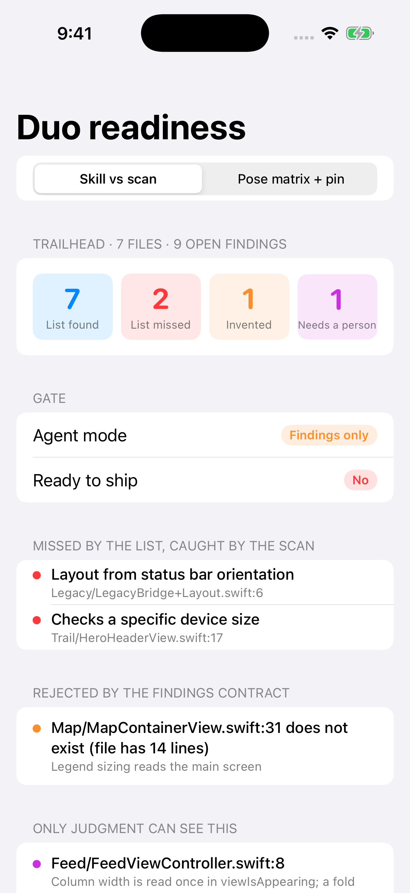
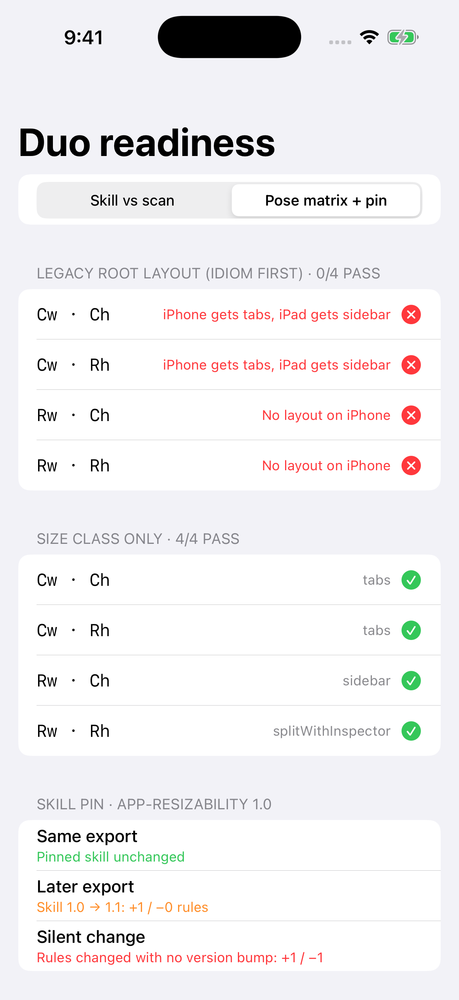

# DuoReadiness — a lead's gate for vendor migration skills

Apple's first step for iPhone Duo readiness is an agent skill: ask Xcode's coding assistant to "get my app ready for iPhone Duo", or export the same skill for another agent with `xcrun agent skills export`. Apple also says the skill "finds most issues, but not all of them" ([Apple — Three steps to make your app shine on iPhone Duo](https://developer.apple.com/iphone-duo/prepare/)).

`DuoReadiness` is the half a vendor skill can't own:

- **`PatternScanner`**: a plain text scan for the text patterns in Apple's Step 2 list (`UIScreen.main`, device / status bar / interface orientation, idiom checks, fixed device sizes, regular width treated as iPad, full-bleed fill). Text after `//` is ignored (block comments are not). Known exceptions, each with a written reason, are filtered out by `Reconciliation`.
- **`FindingsContract`**: checks the agent's findings list like an API response. Every item must cite a real file and line, and a pattern item must cite a line that contains the pattern.
- **`Reconciliation`**: confirmed, missed by the skill, rejected by the contract, and semantic items that need a person.
- **`PoseMatrix`**: the root-layout decision across all four size-class combinations. It must always return a layout, and that layout must not depend on idiom.
- **`SkillManifest` + `PinCheck`**: pins the skill by version *and* rules digest, so a silent content change is caught.
- **`MigrationGate`**: decides the agent mode (unattended, findings only, blocked) and whether the code is ready to ship. `shipReady` covers the scan and the pose matrix only: semantic items in `needsHumanReview` still need a person's sign-off, and the release still needs a pass on the iPhone Duo simulator.
- **`MigrationBrief`**: the brief to hand any agent: skill version and digest, known exceptions, definition of done, findings list before edits.

Article: [Apple’s iPhone Duo Migration Starts With an Agent Skill. Treat It Like a Dependency, Not a Sign-Off.](https://medium.com/@er.rajatlakhina/apples-iphone-duo-migration-starts-with-an-agent-skill-b7f983d41d32)



## The constructed example

`SampleScenario` is a fictional 7-file hiking app ("Trailhead") and a **hand-written** findings list shaped like an agent's skill run. It is not output from Apple's skill.

| | Count |
|---|---|
| Scanner findings | 10 (1 known exception → 9 open) |
| Confirmed by the findings list | 7 |
| Missed by the list | 2 (`statusBarOrientation` in an extension, `height == 844`) |
| Rejected by the contract | 1 (cites line 31 of a 14-line file) |
| Needs a person | 1 (column width read once in `viewIsAppearing`) |
| Pose matrix, legacy policy | 0 / 4 |
| Pose matrix, size class only | 4 / 4 |
| Gate result | **Findings only**, not ready to ship |

```swift
import DuoReadiness

let reconciliation = Reconciliation(
    scanner: PatternScanner.scan(files),
    report: agentFindings,
    files: files,
    exceptions: knownExceptions
)
let gate = MigrationGate(
    reconciliation: reconciliation,
    pin: PinCheck.compare(pinned: pinnedSkill, current: exportedSkill),
    matrix: PoseMatrix(policy: myRootLayout)
)
print(gate.mode, gate.shipReady, gate.reasons)
```

## How to run it

1. `git clone https://github.com/rajatslakhina/iphone-duo-skill-gate-article-demo.git`
2. Open `Demo.xcodeproj` in Xcode.
3. Pick the `Demo` scheme and any iPhone Simulator, then Build & Run.

No other setup: the app uses the package through a local package reference in the same repo. Pass `-screen matrix` as a launch argument to open the pose-matrix screen directly.

Library only: `swift build && swift test`.

## Verification status

- `swift build -Xswiftc -warnings-as-errors` and `swift test` (20 tests, 0 failures) pass on Linux (Swift 6.1.2), and the `library` CI job passed the same two commands on a GitHub-hosted macOS runner (commit `52066e9`).
- The `demo-on-simulator` CI job passed on the same commit: `xcodebuild` (Xcode 16.4, iOS 18.5 SDK) built `Demo.xcodeproj`, the app was installed and launched on an iPhone 17 Pro simulator, the process was still alive after launch, and the two screenshots in `Demo/Screenshots/` were captured from that run (committed by CI in `5b9daf0`).
- Not run on the iPhone Duo simulator from Xcode 27.1, which GitHub-hosted runners don't have.



## License

MIT
